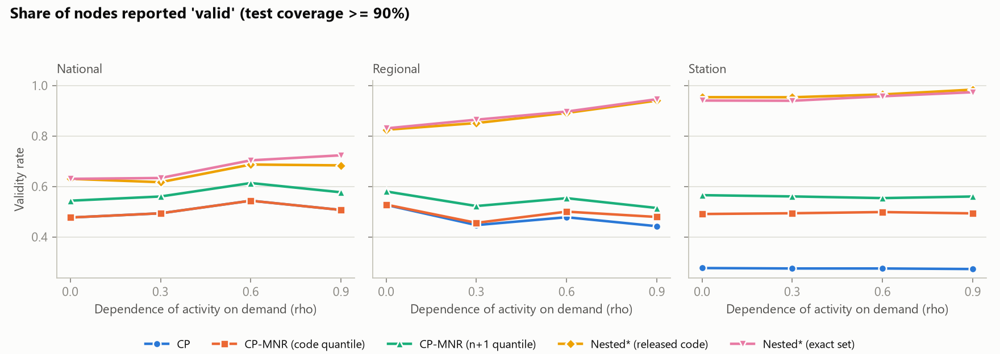
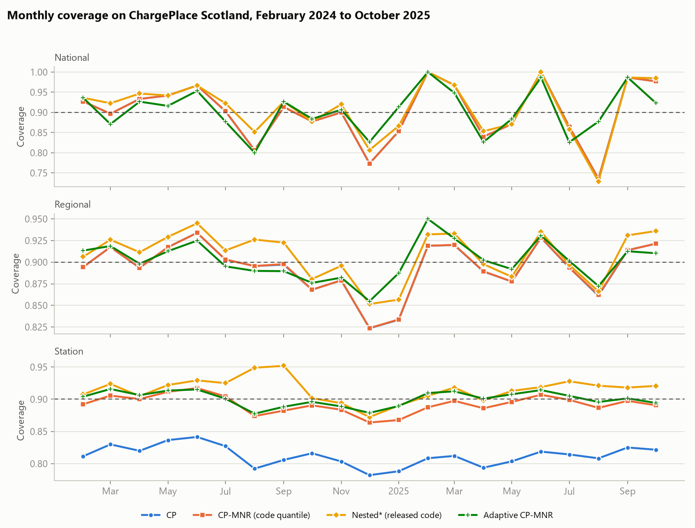
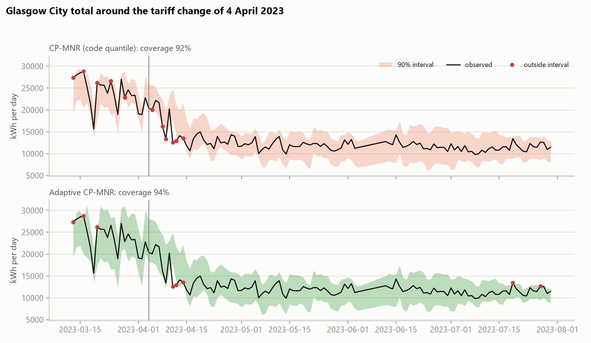
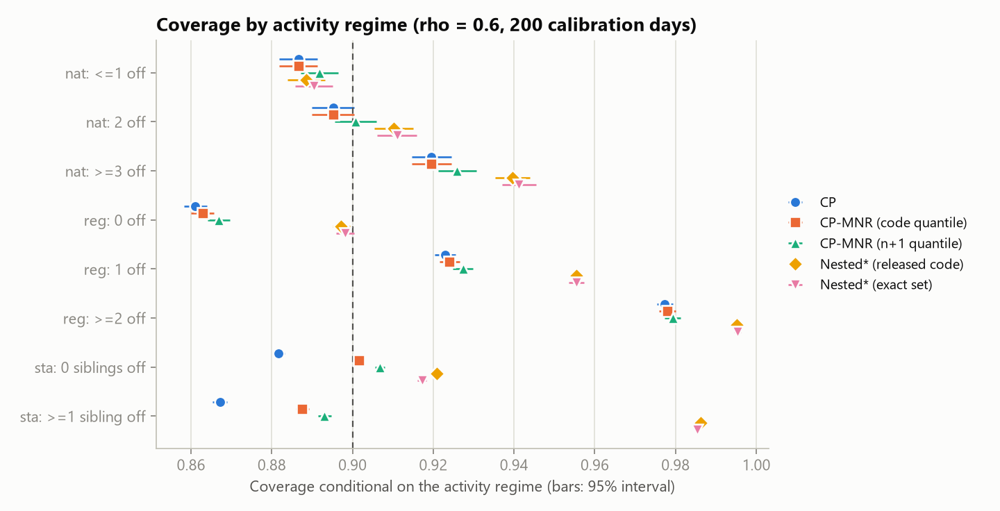

# How much can you trust a forecast's "margin of error"? A check on electric-car charging forecasts

By Muhammad Luqman Hakim.

This project re-examines a recent research paper, [*Probabilistic Forecasting of Electric Vehicle Charging in a Time-varying Hierarchical Infrastructure*](https://arxiv.org/abs/2610.13588) (Principato, Amara-Ouali, Goude, Hamrouche and Poggi, October 2026). I rebuilt the paper's methods from scratch, tested them, and found that the way the paper scores its methods makes one of them look better than it is.

The first half of this page is written for readers with no statistics background. The technical details are further down.

## The short version

- The paper forecasts how much electricity public car chargers in Scotland will use each day, and gives each forecast a range, such as "between 80 and 120 units".
- A range is only useful if it is honest. A "90% range" should contain the real figure about 9 days out of 10.
- The paper recommends a sophisticated method for building these ranges, because it scores best on the paper's own test.
- I found that the test favours ranges that are wider than they need to be. Scored fairly, a much simpler method does just as well and gives tighter, more useful ranges.
- I also found three places where the computer code released with the paper does not do what the paper describes, and reported them to the authors.

## Background, in plain terms

**What is being forecast.** Scotland has a public network of about 1,400 electric-car charging stations. Electricity companies want to know how much power the chargers will draw tomorrow: for each station, for each of Scotland's 32 council areas, and for the country as a whole.

**Why a single number is not enough.** No forecast is exactly right. So a good forecast comes with a range: "tomorrow this station will use between 80 and 120 units, and we are 90% sure". It is the same idea as a weather forecast saying "14 to 18 degrees".

**What makes a range good.** Two things, which pull against each other:

1. **It must be honest.** If you say 90%, the real figure should fall inside the range about 90% of the time. This is called *coverage*.
2. **It should be narrow.** "Between 0 and 1,000,000 units" is always right and completely useless.

Anyone can be right more often by making the range wider. The skill is being right as often as promised with the narrowest range possible.

**What makes this case hard.** Charging stations break down, get repaired, close and open. On a typical day almost half of them record no charging at all. A method that ignores this gives misleading ranges.

## What I found

### 1. The paper's scorecard rewards playing it safe

The paper grades each method by counting how many stations "passed", where a station passes if its range contained the real figure on at least 90% of test days.

That sounds fair, but it has a flaw. Think of a coin that is perfectly fair. Toss it 100 times and you will get 50 or more heads only about half the time, purely by luck. In the same way, a method that is exactly as accurate as it claims will see about half its stations land just under 90% by chance.

I worked out that a perfectly honest method would score only about **53%** on this scorecard. The only way to score much higher is to make the ranges wider than necessary.

So when the paper reports that its simpler method passes at 56% of stations, that is not a weak result. It is what an honest method looks like. And the recommended method's 74% comes from wider ranges, not from being smarter.

### 2. A simple method, corrected, matches the recommended one

The paper describes its simpler method with a standard safety adjustment. The released code leaves that adjustment out. When I put it back, this is what happened on the paper's own test period:

| Method | How often the range was right (target: 90%) | Stations that "passed" | Typical width of the range |
|---|---|---|---|
| Simple method, as coded by the authors | 90.3% | 55% | 390 |
| Simple method, as described in the paper | 92.2% | 73% | 413 |
| Recommended method, as coded by the authors | 92.2% | 73% | 486 |

The corrected simple method is right just as often as the recommended one, passes at just as many stations, and its ranges are about **15% narrower**.

It has one drawback: for stations with very little history (about 2 in every 100 station-days) it cannot give a range at all. Leaving those out, it still passes at 71% of stations.

### 3. A small coding slip flatters the recommended method

The recommended method's code contains a step that shifts both ends of every range slightly downward. I found it by checking the code's output against a slow but obviously correct calculation. Fixing it drops the recommended method's pass rate from 73% to 67%.

A second, related slip: when a station has fewer than 9 comparable past days, the method's own rule says it cannot put any limit on the range, but the code still returns a finite one. Making it honest, the same way as the corrected simple method above, brings the pass rate back to 72% (coverage 91.7%), with the same 2 in 100 station-days left without a usable range. Fully corrected, the recommended method does no better than the corrected simple method, and its ranges are about 19% wider.

### 4. The authors' own worry turned out not to matter

The authors note that their mathematical guarantee relies on an assumption that cannot be true in this setting. I tested this directly in a simulation where I could control how badly the assumption was broken. Breaking it made no difference to how often the ranges were right.

What does go wrong, for every method, is something else: the ranges are too narrow on days when nearly all stations are working and too wide on days when many are down.

### 5. The methods get less reliable as time goes on

The paper tests its methods on six months of data. I tested them on the following 14 months too. Over that later period the simple method's ranges were right 88.8% of the time, short of the promised 90%, and only 38% of stations passed.

### 6. A sudden change makes ranges wasteful, not wrong

In April 2023, Glasgow introduced a new pricing scheme for its chargers, and usage roughly halved. The ranges missed several times in the following two weeks. After that, they stayed much wider than needed, because their width was still being set by forecast errors from the earlier, busier period.

## Why you can trust these results

**I reproduced the paper's numbers first.** Before criticising anything, I checked that my rebuilt version gives the same answers as the paper. The share of stations that passed:

| Method | Paper | My version |
|---|---|---|
| Basic method | 38% | 36% |
| Simple method (CP-MNR) | 56% | 55% |
| Recommended method (CP-MNR-Nested⋆) | 74% | 73% |
| Self-adjusting method (Adaptive CP-MNR) | 58% | 58% |

**The authors have been told.** I reported the code issues to them ([issue #1](https://github.com/PrincipatoG/Probabilistic-Hierarchical-EV/issues/1)). They have not yet confirmed or disputed them.

**The limits of this work are listed** in the technical section below.

## The findings in pictures

In a controlled simulation, the green line is a method that is right almost exactly 90% of the time. It still "passes" at only about 55% of nodes, which shows the scorecard's flaw:



How often the ranges were right, month by month, on the real Scottish data. The dashed line is the 90% target:



Glasgow's daily usage (black line) and the forecast range (shaded) around the tariff change, marked by the vertical line. Red dots are days the range missed:



How often ranges were right, split by how many stations were out of action. No method stays at 90% across all situations:



## Plain-language glossary

| Term | Meaning |
|---|---|
| Prediction interval | The range given with a forecast, such as "80 to 120" |
| Coverage | How often the real figure fell inside the range |
| Validity rate | The paper's scorecard: the share of stations whose coverage reached 90% |
| Conformal prediction | A family of methods that set the width of the range by looking at how wrong past forecasts were |
| Calibration | The step where past forecast errors are used to set the width |
| Hierarchy | Stations add up to council areas, which add up to Scotland |
| Node | Any one point in the hierarchy: a station, a council area, or the national total |

---

# Technical details

## Summary for specialists

- **Validity rate.** With each node's number of active test days, a method with exact 90% coverage has an expected validity rate of about 53% (binomial benchmark). The metric therefore ranks over-coverage above calibration.
- **Quantile rule.** The paper (Section 3.2, Eq. 8) defines the calibration quantile with the `n+1` finite-sample correction. `CP_MNR` in the released code uses `quantile(probs = 1 - alpha, type = 1)`. Restoring the correction yields infinite intervals when a node has fewer than 9 active calibration days.
- **Nested⋆ interval routine.** The closure step `inside | c(inside[-1], FALSE)` in `nested_component` extends one endpoint to the left, so the returned bounds are one order statistic below the hull of `{y : count >= thr}` at both ends. A brute-force test is in `tests/test_core.py`.
- **Nested⋆ with few scores.** With `n` valid calibration scores the threshold is `floor(alpha (n+1))`, which is 0 for `n <= 8` at `alpha = 0.1`. Every `y` then qualifies, so the set is the whole line, but `nested_component` returns the hull of the calibration intervals. The "corrected" variant returns `(-inf, inf)` there (2.4% of station-days on the paper's test period, the same cut-off as the `n+1` quantile).
- **Assumption 3 (activity independent of `(x, y)`).** In simulation with exchangeable days, marginal coverage is flat as the correlation between activity and demand noise goes from 0 to 0.9. Coverage conditional on the activity regime fails for all methods (regional nodes with no station off: 0.867 for CP-MNR, 0.898 for Nested⋆; with two or more off: 0.979 and 0.995).

## Station-level results on the paper's test period

| Method | Coverage | Validity rate | Mean interval length (kWh) |
|---|---|---|---|
| CP | 0.825 | 36.4% | 355 |
| CP-MNR, released code | 0.903 | 55.2% | 390 |
| CP-MNR, `n+1` quantile | 0.922 | 72.9% | 413 |
| CP-MNR-Nested⋆, released code | 0.922 | 72.5% | 486 |
| CP-MNR-Nested⋆, exact interval routine | 0.912 | 67.1% | 487 |
| CP-MNR-Nested⋆, exact routine and infinite below 9 scores | 0.917 | 71.9% | 491 |
| Adaptive CP-MNR | 0.907 | 57.9% | 388 |

Full tables for all levels and periods are in `results/real_summary.csv`; simulation results are in `results/sim.csv`.

## Method

**Simulation.** A synthetic hierarchy of 1 national node, 3 regions and 12 stations with independent days, so exchangeability holds by construction. One parameter, `rho`, sets the correlation between a station's activity and its own unpredictable demand. Each configuration is run 300 times; standard errors on coverage are at most 0.004.

**Real data.** The authors' processed ChargePlace Scotland tables (October 2022 to October 2025): 1,398 stations, 32 local authorities and the national total. The protocol follows theirs: 14-day test windows, models refit for each window, calibration on a random 20% of historical weeks plus the week before the test window, 90% target. Results are averaged over 5 random calibration splits.

**Methods compared.** Plain split conformal (CP), CP-MNR, CP-MNR-Nested⋆ and Adaptive CP-MNR, each transcribed from the released R code, plus corrected variants: CP-MNR with the `n+1` quantile, Nested⋆ with an exact interval routine, and Nested⋆ with the exact routine and an infinite interval when fewer than 9 scores are available. Mean lengths are over finite intervals.

**Scaling.** The authors report needing close to 36 GB of RAM. This runs on an 8 GB laptop because the reconciliation step never forms a 1,431 x 1,431 projection matrix: for a three-level hierarchy the normal equations reduce, by the Woodbury identity, to a 33 x 33 solve per activity pattern (`evconf/hierarchy.py`).

## Limitations

- **Lighter base forecasts.** I use gradient boosting for stations and regions and ridge regression for the national series, in place of the paper's average of random forest, GAM, XGBoost and TabICL. Differences from the paper could partly come from this.
- **Five calibration splits, not ten.**
- **The simulation is small and stylised**: 12 stations, 15% of station-days inactive (the real figure is 46%), no time dependence.
- **The code discrepancies are reported to the authors but not yet confirmed by them** ([issue #1](https://github.com/PrincipatoG/Probabilistic-Hierarchical-EV/issues/1)). They are differences between the released code and, respectively, the paper's stated definition, the set the routine is meant to compute, and the counting rule when fewer than 9 scores are available.
- **Regions with no station active on both days.** Nested⋆ combines the activity masks node by node, so a region can count as active on a calibration day and the test day through different stations. The joint pattern then holds none of its stations, the projection sends the region to 0 on both days, and its score is the whole regional demand. This is wide but not wrong: the score and the test error are built the same way, so they stay exchangeable. It affects about 0.6% of regional scores in a sample of day pairs; dropping those scores instead narrows regional intervals by about 1%. Left as in the released code.
- **I did not reproduce** the paper's 0% national validity for the adaptive method; here it was valid in 3 of 5 splits. The national level is a single node and too noisy to compare.

## Reproducing

```bash
python -m venv .venv
.venv/Scripts/python -m pip install -r requirements.txt     # bin/ instead of Scripts/ on macOS and Linux
.venv/Scripts/python -m pytest tests

# simulation (about 5 minutes on 8 cores)
.venv/Scripts/python scripts/run_sim.py --reps 300
.venv/Scripts/python scripts/plot_sim.py

# real data (about 15 minutes)
# download Data.zip from https://github.com/PrincipatoG/AOAS-EV/releases/latest and extract
# dataset_scotland_main.csv, dataset_region_main.csv and dataset_address_main.csv into data/raw/Data/
.venv/Scripts/python scripts/run_real.py --name extended --seeds 5 --end 2025-10-26
.venv/Scripts/python scripts/run_real.py --name tariff --seeds 5 --test-start 2023-03-13 --end 2023-08-06
.venv/Scripts/python scripts/analyse_real.py
```

## Layout

| Path | Contents |
|---|---|
| `evconf/hierarchy.py` | Summing matrix, activity patterns, fast refined projection |
| `evconf/conformal.py` | The conformal procedures and the corrected variants |
| `evconf/simulate.py` | Synthetic hierarchy and one simulation replication |
| `evconf/data.py`, `evconf/realdata.py` | Data loading, features, rolling-window experiment |
| `scripts/` | Run and plotting scripts |
| `tests/` | Unit tests, including the brute-force check of the interval routine |
| `results/` | Summary tables (`sim.csv`, `real_summary.csv`, `real_glasgow.csv`) and figures |

## Credits

Methods and data are due to the paper's authors; their code is at [PrincipatoG/Probabilistic-Hierarchical-EV](https://github.com/PrincipatoG/Probabilistic-Hierarchical-EV) (MIT licence). The data comes from ChargePlace Scotland via the [GridCharge](https://huggingface.co/datasets/djordjebatic/GridCharge) dataset and is not redistributed here.
